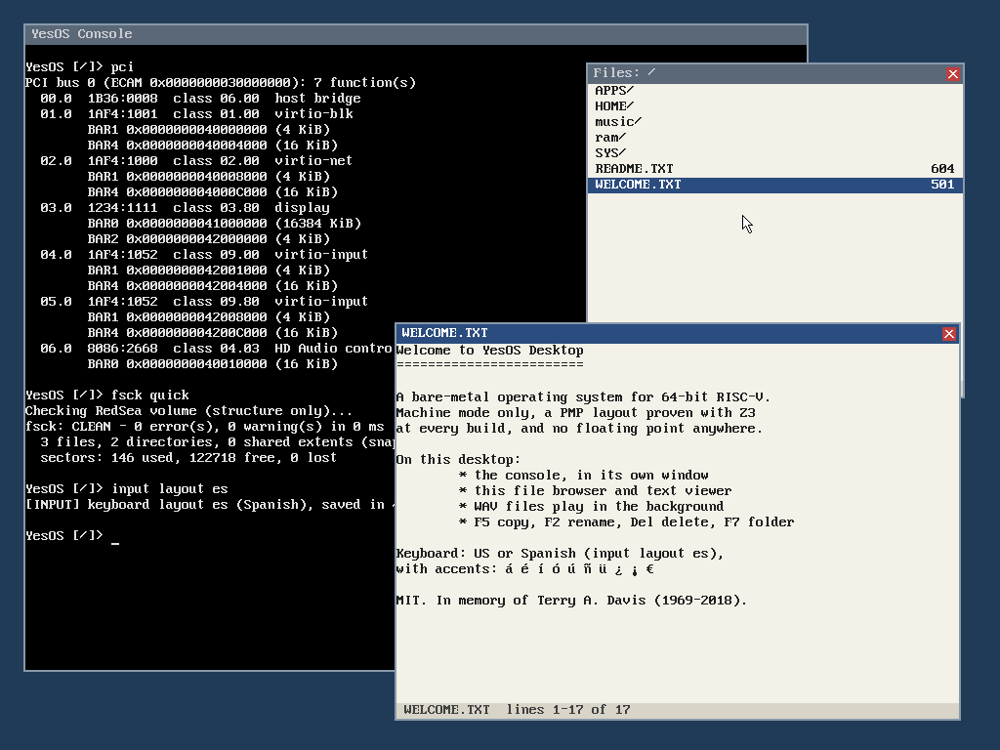

<div align="center">

# YesOS Desktop

**A desktop for bare-metal RISC-V: windows, a file browser and sound,<br>
on a kernel whose memory protection is proven at every build.**


[Quick start](#quick-start) · [Features](#at-a-glance) · [Tests](#tests) · [Limits](#honest-limits) · [YesOS core](https://github.com/yesos-project/yesos-core)

<br>



<sub>The real screen: QEMU's <code>screendump</code> of YesOS Desktop, made by <code>tools/screenshot.py</code>. Nothing is drawn on top.</sub>

</div>

---

The desktop product of YesOS, built on the YesOS core (the `core` git
submodule): Machine mode only, a locked Z3-proven PMP, an integer-only kernel
(no floating point, checked at every build), no Linux, libc or binary blobs.
It has no network services, and of the core's optional modules it takes only
`gfx` (the font) and `lineedit` (console line editing). Features come over
one at a time from the old desktop experiments in `yesos-lab`, each with its
own tests.

## At a glance

| | What | Source |
|---|---|---|
| 🪟 | **Desktop**: overlapping windows with their own contents off the screen, composed only where something changed; drag, raise, close | `src/desktop.c`, `src/surface.c` |
| 📁 | **File browser** on the RedSea disk: open, play, view; copy, rename, delete, new folder | `src/files.c` |
| 📄 | **Text viewer**: UTF-8, tabs, scrolling | `src/files.c` |
| 🔊 | **HD Audio**: tones, WAV files bit for bit, playback in the background | `src/hda.c`, `src/wav.c`, `src/audio_shell.c` |
| ⌨️ | **Keyboard and tablet** (virtio): US and Spanish layouts with dead keys, a pointer | `src/input.c` |
| 🖥️ | **Console on the screen**: in its window or the whole screen, with line editing and history | `src/terminal.c` |
| 🎨 | **Framebuffer** (bochs-display) and the core's 8x16 font, Latin-1 and € | `src/display.c` |

## Quick start

Requirements (clang, lld, llvm, QEMU, Rust, Python): see the
[yesos-core README](https://github.com/yesos-project/yesos-core#readme).

```bash
git clone --recurse-submodules https://github.com/yesos-project/yesos-desktop && cd yesos-desktop
make prover-setup        # once (Z3, in core/tools/.venv)
make                     # yesos.elf
make run-gui             # the screen in a window (UI=gtk, or UI=sdl): type there or in the terminal
make run                 # serial console only (Ctrl-A X to quit), sound via PulseAudio
make run AUDIO=none      # the same without sound (or AUDIO=pipewire, alsa)
make test                # tools/test_*.py: desktop, audio, display, input, window, files, fileops
```

In the window, try `files`, then the arrows and Enter; `input layout es`
for a Spanish keyboard; `help` for everything else.

Design choices, a comparison with Linux, seL4, Zephyr and TempleOS, and what
is measured today: see the
[yesos-core README](https://github.com/yesos-project/yesos-core#2-design-choices).

## Desktop and windows

- A plain background and **overlapping windows**, up to 8. Window 0 holds
  the console and cannot be closed; the file browser and the viewer open
  their own; `window new` and `window text` make plain ones.
- Each window keeps its **contents in its own buffer** off the screen
  (`Surface`). The screen is **composed** only where something changed:
  background, the windows from the bottom up, the pointer on top. Text
  written into a covered window shows only where it is visible, and what a
  moved or closed window covered comes back.
- A **press** on a window brings it to the front and gives it the focus
  (blue title bar; the others are grey). The **title bar drags** it; the
  **box** at its right closes it. Windows always stay whole on the screen.
  **Keys go to the focused window** if its program takes them, else to the
  console.
- `desktop off` gives the whole screen to the console; `desktop on` puts
  the windows back. A mode change lays everything out again.

```text
Desktop     desktop [status]   desktop on   desktop off   desktop move <x> <y>
            window [list]   window new <cols> <rows> <title>   window text <id> <col> <row> <rrggbb> <text>
            window front <id>   window move <id> <x> <y>   window close <id>
```

## File browser and viewer

- `files [path]` opens a **browser** on a directory of the RedSea disk
  (through the VFS, which also shows the RAM file system in the same tree):
  `..` first below the root, sizes on the right, a selection bar and a
  status line.
- **Arrows, Home, End, Page Up/Down** move; **Enter or a double click**
  opens; **Backspace** goes up. A directory is entered; a **`.wav` file
  plays in the background** (the status line says when it has ended); any
  other file opens in the **viewer** if it is text (no NUL byte, at most
  1 MiB), else the status line says why not.
- **File operations**, the name typed in the status line (**Esc** cancels):

  | Key | Does |
  |---|---|
  | **F5** | copy a file, to a name in the same folder or a path such as `sub/copy.txt` |
  | **F2** | rename a file: on the RedSea disk a second name for the data, then the old one removed, so a power cut in between leaves both names and loses nothing |
  | **Delete** | delete a file or an empty folder, after Enter |
  | **F7** | make a folder |

  A name that exists or is not valid is refused; a folder that is not empty
  is not deleted (RedSea would leave its files behind).
- The **viewer** shows the lines cut at its width, tabs to 8 columns,
  control characters as `?`; the arrows, Page Up/Down, Home and End scroll.

```text
Files       files [path]   files list
            in the browser: F5 copy  F2 rename  Delete delete  F7 new folder  Esc cancel
```

## Keyboard and pointer

- **virtio-input** (PCI 1AF4:1052): QEMU's `virtio-keyboard-pci`,
  `virtio-tablet-pci` and `virtio-mouse-pci`, up to 4, each recognised by
  the event types it reports; polled from the main loop. Rewritten from the
  lab's driver: BARs from the core's PCI allocator (the lab used its own
  fixed window), rings in their natural layout (the lab's were packed, the
  bug that once made virtio-blk read torn indexes), the tablet's axis range
  read from the device.
- **Keyboard**: Linux key codes to UTF-8. Layouts `us` and `es` (Spanish:
  ñ, ¿ ¡, ç, º ª, AltGr for @ # | € [ ] { }, and dead keys: ´ ¨ ` ^ with a
  vowel give á ü à â …, with a space the accent itself). Shift, caps lock,
  keypad; Ctrl and Alt combinations type nothing. The layout is kept in
  `/input.cfg` on the disk and used again at the next boot.
- **Editing keys** reach the console as the escape sequences a terminal
  sends, so the core's line editor (cursor inside the line, the last 16
  commands with up and down) works the same from the window and from the
  serial port; in a window they go to its program.
- **Pointer**: an arrow at the tablet's position (axis 0..max scaled to
  0..width-1), or moved by a mouse; the pixels under it are put back when it
  moves, and all drawing happens under it.

```text
Input       input [status]   input layout us|es
```

## Console on the screen

Everything the console writes is also drawn on the display, in the
console's window or, with `desktop off`, on the whole screen: the core's
kprintf hook sees it, and the shell's echo of typed characters goes through
it too. 100x40 characters in the window (128x48 on the whole screen at
1024x768), with UTF-8, a cursor, scrolling, line wrap (backspace goes back
over it), tabs and the ANSI sequences the core prints (colours 30–37, clear
screen). `term off` leaves the screen to the `display` commands.

```text
Terminal    term [status]   term on   term off   term clear
```

## Display

- QEMU's **bochs-display** (PCI 1234:1111), found through the core's PCI
  enumerator, which assigns its BARs: the framebuffer (BAR0, 16 MiB) and the
  Bochs VBE "DISPI" registers (BAR2 + 0x500).
- 32 bits per pixel, 1024x768 at boot; `display mode` sets any mode the
  device accepts, read back from the registers (up to 4096x4096 and the size
  of video memory); a refused mode falls back to 1024x768.
- **Text** in the core's 8x16 font (`fonts/yesos-8x16.txt` in the core):
  ASCII, the Latin-1 letters of Spanish and the Western languages' accented
  vowels, and €; anything else is drawn as `?`. The font comes from the
  lab's (its own drawing in the style of the VGA font, not a copy) with real
  descenders for g j p q y and the accented letters added.

```text
Display     display [status]   display test   display clear [rrggbb]   display mode <w> <h>
            display print <x> <y> <rrggbb> <text>
```

## Audio

- **Intel High Definition Audio**, found through the core's `drivers/pci.c`
  and driven by polling. The codec is discovered, not assumed: its output
  converter and pin are found by asking it, and the amplifier is set to the
  step the codec reports as 0 dB, so the output level is exact.
- One stream, 16-bit stereo, from a DMA ring of 16384 frames (341 ms at
  48 kHz), at any rate the codec reports among 8–192 kHz (QEMU's: 16, 22.05,
  32, 44.1, 48, 88.2 and 96 kHz). The ring is filled before the DMA starts
  and kept full of silence while a sound drains, so old samples are never
  replayed.
- **Tone generator:** a 32-bit phase accumulator reading a 1024-point Q15
  sine table (`tools/gen_sine_q15.py`). Integer only.
- **WAV files from RedSea**: 16-bit PCM, mono or stereo, at the file's own
  rate (no resampling: the samples reach the codec unchanged). Every chunk
  size is checked against the file size; what cannot be played is refused
  with a message.
- **In the background** (`audio start`, and the file browser): the main loop
  keeps the ring filled (it runs every millisecond), so the desktop keeps
  working while it plays. One sound at a time. If the main loop is held up
  for longer than the ring, the DMA plays old samples: that is detected from
  the clock and counted as an underrun. `audio play` and `audio tone` wait
  until they have played.
- **Pisano counter:** beside the ring runs the Fibonacci recurrence modulo
  the ring size, which wraps after exactly one Pisano period,
  π(2^14) = 3·2^13 = 24576 steps, verified at init. It is telemetry: the
  samples are placed linearly.

```text
Audio       audio [status]   audio tone <Hz> <ms> [level %]   audio play <file.wav>
            audio start <file.wav>   audio stop
```

## Tests

Every suite boots the real image in QEMU. Screens are compared **pixel for
pixel** with pictures computed by the test (`screendump`), sound **bit for
bit** with what was written (QEMU records the output to a WAV file), and
input is sent through QEMU's QMP socket as the window would send it. For
the newer suites, faults were put in on purpose to see them caught (below).

| Suite | Checks | What it covers |
|---|---:|---|
| `test_desktop.py` | 17 | boot with the PMP proven, the console, nothing on the network, a file across a reboot, UTF-8 input, fsck |
| `test_audio.py` | 38 | tones (duration, frequency, level, SINAD), WAV files bit for bit, bad files refused |
| `test_display.py` | 23 | modes, test pattern, text in four colours, clipping, no display |
| `test_input.py` | 35 | both layouts exactly, editing keys, the layout across a reboot, pointer, clicks, wheel, the console on the screen |
| `test_window.py` | 35 | one and several windows: drags, raise, focus, close, a covered console, at most 8 |
| `test_files.py` | 30 | browser and viewer, keys to the focused window, WAV files in the background |
| `test_fileops.py` | 24 | copy, rename, delete, new folder, every refusal, fsck, the disk after a reboot |

<details>
<summary><b>Audio</b>: measured tones and WAV files</summary>

| Tone | Duration | Frequency | Level | SINAD |
|---|---|---|---|---|
| 1000 Hz, 50 % | 1500.0 ms (asked 1500) | 1000.00 Hz | −9.03 dBFS (expected −9.03) | 55.6 dB |
| 440 Hz, 25 % | 1000.0 ms (asked 1000) | 440.00 Hz | −15.05 dBFS (expected −15.05) | 55.0 dB |

Both channels are identical and there are no underruns. A SINAD (signal
against noise and distortion) of about 55 dB is what a 1024-point table read
without interpolation gives.

| File | Result |
|---|---|
| 48 kHz stereo, 0.5 s (a tone with noise on the left, full-range noise on the right, both extremes) | all 24000 frames bit for bit |
| 44.1 kHz mono, 0.5 s (a sweep and both extremes), in a second run recorded at 44.1 kHz | all 22050 frames bit for bit, on both channels |
| a text file; an 8-bit WAV; a chunk longer than the file; 12345 Hz; a missing file | each refused with its reason, no kernel fault |

</details>

<details>
<summary><b>Display</b>: what is drawn and compared</summary>

The black screen, the test pattern at 1024x768, 800x600 and 1280x720, a
solid colour, and Spanish text in four colours with a missing glyph (→) and
a line clipped at the right edge, all pixel for pixel. A 9000x9000 mode is
refused; without a display device the system boots, says so, and the
commands refuse cleanly.

</details>

<details>
<summary><b>Input</b>: what is sent and what arrives</summary>

| What is sent | Result |
|---|---|
| US layout: letters, shifted symbols, digits | the shell receives exactly the typed line |
| backspace, caps lock (and shift with it), Ctrl+H, Alt+H, keypad | `qq abcDEFg12+3*4-/.` |
| Spanish layout: ñ Ñ ¡ ¿, dead keys with vowels and with space, ç º ª, shifted digits, AltGr | `ñÑ¡¿?áÉüÜòî´´nçǺª"·/=@#\|€[]{}+*<>-_;:ÑA`, exact |
| backspace after á and ñ | each removed whole |
| left, Home, End, Delete, up/down | the line edited as expected; history recalled |
| `input layout es`, reboot on the same disk | the boot says `layout es`; ñ and ó type as Spanish |
| tablet at 4 positions, corners included | the pixel expected from the axis range |
| clicks (left twice, right, middle), wheel 3 up 1 down | counted, at the pointer, all released; wheel 2 |
| pointer over a plain colour, moved, in the corner, text drawn across it | arrow on top, old place repainted, clipped |
| typed text, command output, two `help` (the screen scrolls) | the screen equals the serial stream replayed by the test's own terminal |

</details>

<details>
<summary><b>Windows</b>: the two stages and the faults it catches</summary>

| Stage | What is checked |
|---|---|
| 1 | the console's window at boot, dragged, moved from the console with text typed at the new place, small overlapping moves; presses outside the title bar move nothing; a drag past the edge stops with the window whole; `desktop off`/`on`; 800x600 |
| 2 | three windows, the newest on top and focused; a press on the console brings it over the others; `window front`; a window dragged over the console; text typed into the console under another window; the close box; the console's window cannot be closed; at most 8 windows; all closed again |

Faults put in on purpose: a background band left unpainted after a move
(3 comparisons fail, 98 350 pixels); window contents drawn straight onto
the screen instead of composed (4 064 pixels); the grey of a title bar one
step off (5 comparisons fail).

</details>

<details>
<summary><b>Files</b>: browser, viewer, background sound, file operations</summary>

`test_files.py` puts a text file (tab, UTF-8, a control character, a long
line, 60 lines), a binary file and WAV files on the disk and drives
everything with keys and the tablet: `docs/` entered with Enter, `hola.txt`
opened, the viewer closed by its box, Backspace back to `/`, `LONG.TXT`
opened with a double click and scrolled — each screen pixel for pixel. Keys
typed with the browser focused do not reach the console, and do after a
press on the console; `BIN.DAT` is refused as not text; `TONE.WAV` comes out
bit for bit. A 3-second WAV is started from the browser and, while it still
plays, the browser answers two keys (the screen is compared); it ends with
no underrun and comes out bit for bit; `audio stop` stops it early. With the
browser waiting while it plays, six checks fail; a tab width of 4 in the
viewer is caught (636 pixels).

`test_fileops.py` copies, renames and deletes with the keys and checks the
listing and the files' contents after each step; a name that exists, a name
with `/` for a rename, Delete then Esc, a folder that is not empty and
renaming a folder are refused; a copy into a new folder, the folder emptied
and deleted; the question in the status line pixel for pixel; `fsck` clean;
after a reboot the disk holds what it should. A rename that keeps the old
name makes 5 checks fail.

</details>

## Honest limits

- **Tested with QEMU's devices only**; a real board would need its own
  display, input and audio drivers.
- Windows cannot be resized or minimised; the console is the only window
  that takes text input as a command line.
- The browser lists at most 64 entries per directory, and does not copy or
  rename folders; the viewer does not wrap lines.
- One sound at a time; a WAV file is read into memory whole (heap 128 MiB).
- Only the boot hart draws on the screen; output of the other harts reaches
  the serial port only (counted as "dropped" by `term`). No scrollback.
- No Ctrl shortcuts, no keyboard LEDs; the font has no glyphs beyond
  Latin-1 and €.

## A note on "EML" audio

The audio processing in `yesos-lab` labelled "EML" (resampler, dither,
limiter) turned out to be conventional fixed-point code: it uses none of the
EML number system. It was brought over and measured once (yesos-desktop
commit `d900e40`) and then taken out again. The EML number system itself
(`eml64_t`, logarithmic) is evaluated in `yesos-lab` first, for accuracy and
instruction cost; it comes here only if it measures as worth having.

## Support YesOS

YesOS is developed in the open and funded by donations. They pay for
development time and for real RISC-V boards, so the missing storage and
network drivers can be written and tested outside the emulator.

[Donate on Liberapay](https://liberapay.com/yesos-project/donate)

## License

MIT. In memory of Terry A. Davis (1969–2018).

YesOS is inspired by his TempleOS (its HolyC became HolyQ here, and the
RedSea filesystem) and is not affiliated with it.
